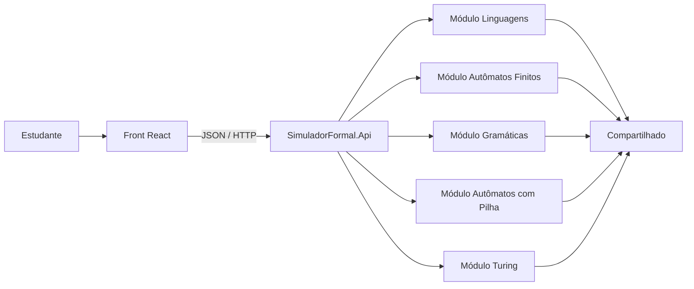
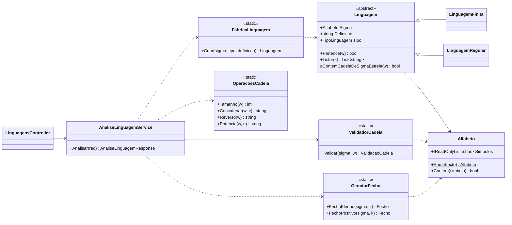
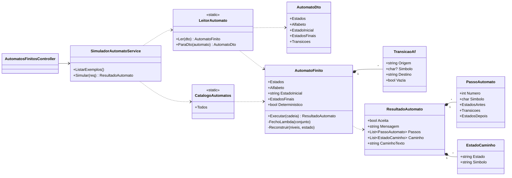
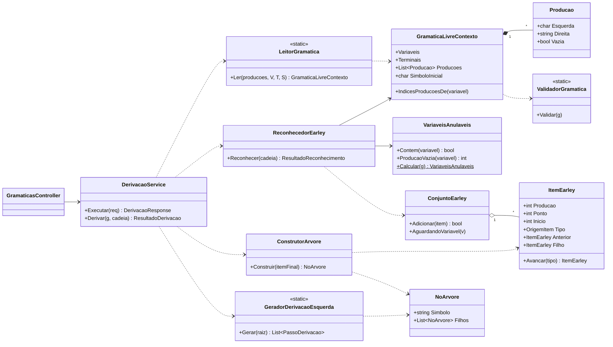
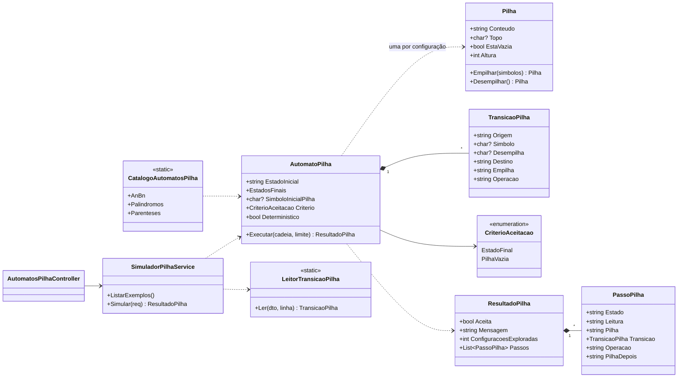
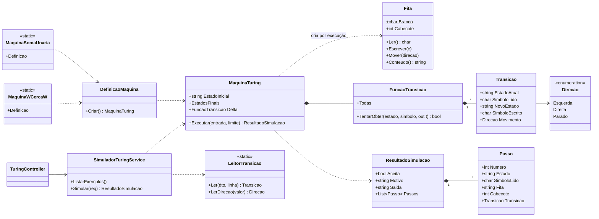
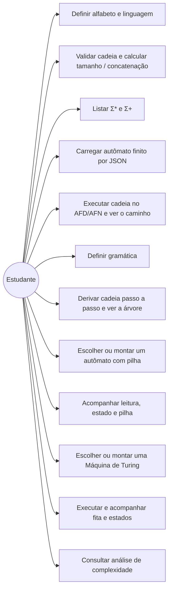
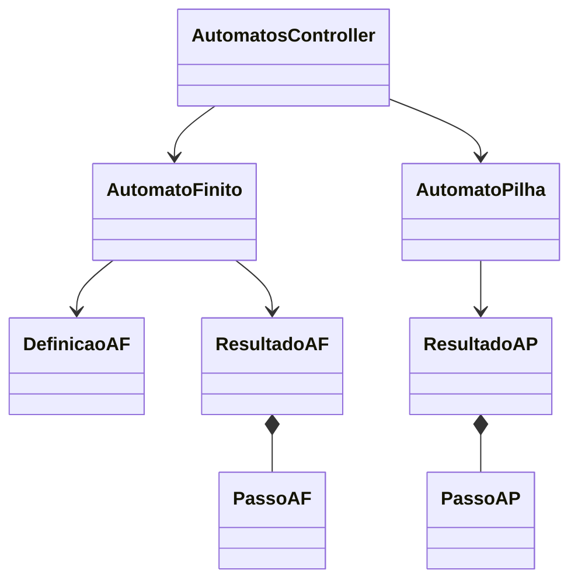

# Arquitetura

O backend é organizado **por módulo** (fatias verticais). Cada módulo do enunciado é um projeto .NET independente que contém tudo o que precisa: domínio, operações, contratos JSON, serviço e controller. A API é apenas o host que junta os módulos.

| Projeto | Papel |
|---|---|
| `SimuladorFormal.Api` | Host ASP.NET Core: configura JSON, CORS, arquivos estáticos e chama `AddModuloX()` de cada módulo. |
| `SimuladorFormal.Compartilhado` | Convenções usadas por mais de um módulo: λ (`Simbolos`) e leitura de conjuntos como `{a, b}` (`LeitorSimbolos`). |
| `SimuladorFormal.Linguagens` | Módulo 1 — Linguagens formais. |
| `SimuladorFormal.AutomatosFinitos` | Módulo 2 — Autômatos finitos (AFD, AFN, AFN-λ) carregados por JSON. |
| `SimuladorFormal.Gramaticas` | Módulo 3 — Gramáticas livres de contexto. |
| `SimuladorFormal.AutomatosPilha` | Módulo 4 — Autômato com pilha. |
| `SimuladorFormal.Turing` | Módulo 5 — Máquina de Turing. |
| `SimuladorFormal.Tests` | Testes xUnit, uma pasta por módulo. |



Os módulos não dependem uns dos outros: dá para remover ou trocar um sem mexer nos demais.

## Camadas dentro de cada módulo

Todos os módulos seguem as mesmas pastas, e o fluxo de uma requisição é sempre o mesmo:

```
Api/Controller  →  Servicos/Service  →  Leitura (texto → domínio)  →  Dominio / algoritmos  →  Contratos (resposta JSON)
```

| Pasta | Responsabilidade |
|---|---|
| `Dominio/` | Os modelos teóricos (Alfabeto, Gramática, Máquina de Turing…) e suas regras de validação. |
| `Leitura/` | Converte o texto ou JSON recebido (ex.: `S -> aSb \| λ`, `R/L/S`, o JSON do autômato) em objetos do domínio. |
| `Operacoes/`, `Earley/`, `Derivacao/`, `Analise/`, `Execucao/` | Os algoritmos do módulo e seus resultados. |
| `Exemplos/` | Autômatos e máquinas prontos (módulos 2, 4 e 5). |
| `Contratos/` | Requisições e respostas da API (formato do JSON). |
| `Servicos/` | Orquestra um caso de uso de ponta a ponta. |
| `Api/` | Controller HTTP (fino: só chama o serviço). |
| `ModuloX.cs` | Registra o serviço e o controller do módulo na aplicação. |

## Diagramas de classes (UML)

### Módulo 1 — Linguagens formais



### Módulo 2 — Autômato finito



### Módulo 3 — Gramática livre de contexto



### Módulo 4 — Autômato com pilha



### Módulo 5 — Máquina de Turing



## Casos de uso



## Estruturas de dados

| Onde | Estrutura | Por quê |
|---|---|---|
| `Alfabeto` | `HashSet<char>` + lista ordenada | Pertinência O(1); a ordem define a ordem lexicográfica de Σ*. |
| `LinguagemFinita` | `HashSet<string>` | Pertinência em tempo proporcional a \|w\|. |
| `AutomatoFinito` | `Dictionary<(estado, símbolo?), List<destino>>` | δ de AFN em O(1) por (estado, símbolo); a chave com símbolo nulo guarda as transições λ. |
| `AutomatoFinito.Executar` | lista de níveis `Dictionary<estado, origem>` | O conjunto de estados ativos de cada passo, com o predecessor de cada um para reconstruir o caminho. |
| `Pilha` | `string` imutável, topo à esquerda | Cada ramo não determinístico tem sua pilha sem cópias defensivas; igualdade por valor para o `HashSet` de configurações. |
| `AutomatoPilha.Executar` | fila (BFS) + `HashSet<Configuracao>` + lista de nós com ponteiro para o pai | Explora todos os ramos sem repetir configurações e reconstrói a computação que aceitou. |
| `ConjuntoEarley` | `List<ItemEarley>`, `HashSet` de chaves `(produção, ponto, início)` e `Dictionary<variável, itens que a esperam>` | Evita itens duplicados e torna a conclusão proporcional só aos itens relevantes. |
| `ItemEarley` | ponteiros para o item anterior e para o filho | Permite reconstruir a árvore sem nova busca. |
| `Fita` | `List<char>` que cresce nas duas pontas | Simula a fita infinita. |
| `FuncaoTransicao` | `Dictionary<(string, char), Transicao>` | δ em O(1) e detecção de não determinismo na construção. |

### Módulos 2 e 4 — Autômatos

`AutomatosController` recebe o JSON e delega a `AutomatoFinito` ou
`AutomatoPilha`. Ambos devolvem veredito e configurações para o React.
O AF indexa as regras por (origem, símbolo). O AFD avança um estado por vez;
o AFN guarda um conjunto de estados ativos e aplica fecho λ com fila e
conjunto de visitados, evitando repetir ciclos. O AP usa `Stack<char>` e
registra a ação e o conteúdo da pilha depois de cada símbolo.



Caso de uso AF: importar configuração, informar cadeia, executar e
percorrer estados ativos. Caso de uso AP: informar cadeia, executar e
percorrer operações e configurações da pilha.
